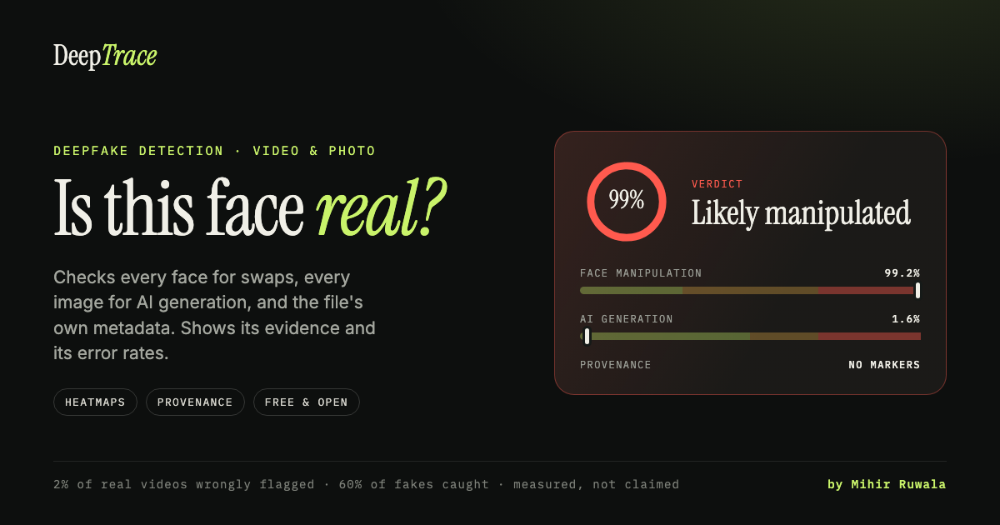

# DeepTrace

Is this face real? DeepTrace checks a video or a photo for face swaps, re-enactment and AI generation, reads the file's own metadata, and shows you the evidence behind its answer. When it can't tell, it says so.

**Try it:** [huggingface.co/spaces/ruwalamihir/deepfake_detector](https://huggingface.co/spaces/ruwalamihir/deepfake_detector)



## What it checks

| Step | What happens |
|---|---|
| Sample | 16 frames spread evenly over the clip (a photo is used as it is) |
| Detect | OpenCV's YuNet finds faces; each person is tracked and scored separately |
| Face manipulation | Two EfficientNet-B7 checkpoints from the winning entry of the Deepfake Detection Challenge |
| AI generation | The Community Forensics ViT-S/16-384 detector, on whole frames and face crops |
| Provenance | The file's metadata is read for IPTC AI labels, generator settings, Content Credentials (C2PA) and camera tags |
| Quality gate | A face that is too dark or too blurry gets no verdict |
| Decide | Mean score up to 0.30 is clean, from 0.70 is flagged, anything between is inconclusive |
| Explain | An annotated key frame, plus heatmaps of where on the face the evidence sits |

Every result can be exported as a self-contained HTML evidence report.

## How well it works

Measured end to end, with the same settings the app uses:

- 88 real videos: 63 clean, 23 inconclusive, 2 wrongly flagged
- 75 fake videos: 45 flagged, 25 inconclusive, 5 passed as clean
- 85 real photos: 3 wrongly flagged
- 120 AI-generated face photos: 87 flagged, 19 passed as clean

It is weakest on modern commercial face swaps, and fully AI-generated video has not been tested. [EVALUATION.md](EVALUATION.md) has the test sets, the per-dataset numbers, what was tried and rejected, and what these numbers don't show.

This is a screening tool. It misses some fakes and can be wrong about real footage, so never use it alone to accuse anyone.

## Run it yourself

```bash
pip install -r requirements.txt
python3 download_weights.py      # ~300 MB, from the Hugging Face Space
streamlit run app.py
```

Or with Docker, the way the Space runs it:

```bash
python3 download_weights.py
docker build -t deeptrace . && docker run -p 7860:7860 deeptrace
```

`engine.py` has no UI code, so you can also use it directly:

```python
import cv2
from engine import Engine

result = Engine().analyse_video("clip.mp4")      # or .analyse_image(cv2.imread("photo.jpg"))
print(result.verdict, result.swap_prob, result.aigen_prob, result.notes)
```

## Files

| File | What it is |
|---|---|
| `app.py` | The Streamlit interface |
| `engine.py` | Face detection, both detectors, heatmaps and the verdict |
| `provenance.py` | The metadata check |
| `EVALUATION.md` | How it was tested |
| `download_weights.py` | Fetches the model weights |

## Credits

- Face-manipulation weights: Selim Seferbekov, [dfdc_deepfake_challenge](https://github.com/selimsef/dfdc_deepfake_challenge) (MIT), converted to fp16 safetensors.
- AI-generation weights: Park and Owens, [Community Forensics](https://github.com/JeongsooP/Community-Forensics), CVPR 2025 (MIT).
- Face detector: [YuNet](https://github.com/opencv/opencv_zoo/tree/main/models/face_detection_yunet), OpenCV model zoo (MIT).

The first prototype, a Streamlit app built on a PyTorch model called FuNet-A, is kept in [prototype/](prototype/).

Built by [Mihir Ruwala](https://mihirruwala.cv).
